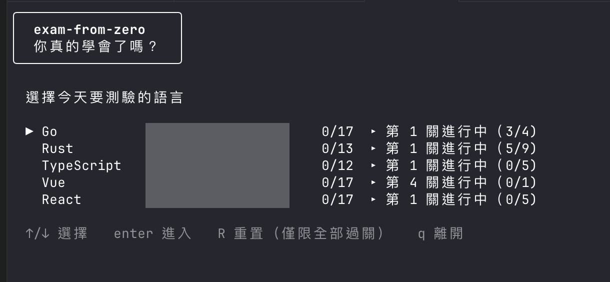
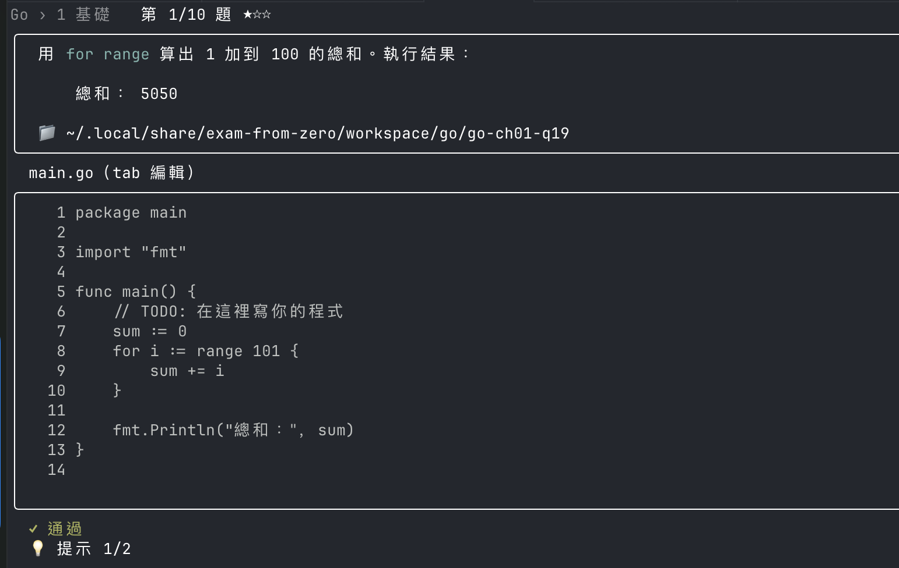

[](https://creativecommons.org/licenses/by-nc-nd/4.0/deed.zh-hant)
[](https://creativecommons.org/publicdomain/zero/1.0/deed.zh-hant)

# exam-from-zero

給讀完「從零開始學」系列、想確認自己學會多少的人用的測驗程式。在終端機裡作答，程式題會實際執行你寫的程式碼來判定對錯。





## 安裝

只支援 macOS 與 Linux。Windows 無法建置，WSL 也許可以，但沒有測試過。

| 工具 | 什麼時候需要 |
| --- | --- |
| Go 1.25.14 以上 | 一定要有，用來建置本程式，也用來判定 Go 題目 |
| cargo | 只有 Rust 題目需要 |
| Node.js 22.22.2 以上的 22 版、24.15 以上的 24 版，或 26 以上 | 只有 TypeScript、Vue、React 題目需要 |

```bash
go install github.com/holmeslin/exam-from-zero@latest   # 預設裝到 $(go env GOPATH)/bin，請確認它在 PATH 裡
```

也可以自己建置：

```bash
git clone https://github.com/holmeslin/exam-from-zero.git
cd exam-from-zero
go run .     # 直接執行
go build     # 或建置出 ./exam-from-zero
```

缺少某個工具時，主選單上那個語言會變灰，顯示「✗ 缺少 cargo」這類訊息，游標會跳過它，其他語言照常可用。

以下兩種情況需要網路：

- 第一次進入 TypeScript、Vue、React 時，會在 workspace 執行 `npm install`（最多 10 分鐘），畫面上即時顯示輸出。安裝失敗時按 enter 重試。題庫更新了共用依賴時會再安裝一次。
- Rust 第一次判定時會下載並編譯依賴，選單上會顯示「⚙ 首次判定會下載並編譯依賴」，可能要一到兩分鐘。

## 開始測驗

```bash
exam-from-zero
```

1. 在主選單選語言，按 enter。
2. 在關卡清單選一關，按 enter。還沒解鎖的關卡顯示 🔒。
3. 作答。程式題可以按 `tab` 直接在畫面裡編輯，也可以按 `e` 用外部編輯器開啟，寫好後按 enter 判定。
4. 答對後按 enter 進下一題。整關答完就過關，同時解鎖下一關。

作答中按 esc 可以離開，進度會保留，下次進入同一關從原本的地方繼續。任何畫面按 `ctrl+c` 都會結束程式。

## 規則

- 關卡依序解鎖。每關從題目池抽出固定題數（關卡清單的「題數」欄），由易到難排列，難度用 ★ 標示。
- 每題都要答對才能過關。答錯可以重答，次數不限。
- 第一輪答錯過的題目，最後會再考一次。程式題的 workspace 會先重設回 starter，要從頭再寫。
- 每題有兩層提示，並附上書中對應的位置（📖）。看過提示會留下紀錄，但不扣分。
- 選擇題的選項每次出現都會重新排列。
- 簡答題會先去掉頭尾空白、把連續空白合併成一個，再不分大小寫比對。整段答案要和正解一樣才算對，所以只填題目問的那個東西（例如型別名稱、指令），不要加說明文字或句號；同一題可能接受幾種常見寫法。
- 程式題分兩種：跑隱藏測試，或比對程式輸出（有些題目會從 stdin 餵資料）。比對輸出時必須完全相同。
- TypeScript、Vue、React 題目會先做型別檢查（Vue 用 vue-tsc，其他用 tsc），型別錯誤顯示「✗ 編譯錯誤」。Vue 與 React 第 1～3 章教的是 JavaScript，不做型別檢查。
- 判定是在 workspace 旁邊的暫存複本 `_grade-<題目 id>` 裡跑，隱藏測試不會出現在你的 workspace。
- 每個步驟的時間上限：Go、TypeScript、Vue、React 是 10 秒，Rust 是 120 秒。超過會顯示「⏱ 逾時」。
- 覺得題目有問題可以檢舉。這題之後不會再出現，並從同一關還沒出過的題目補一題；沒有剩下的題目就不補。
- 一種語言全部過關後，才能在主選單按 `R` 重置它，從頭再來。

## 按鍵

### 主選單

| 按鍵 | 動作 |
| --- | --- |
| ↑/↓ 或 k/j | 選擇語言 |
| enter | 進入 |
| `R` | 重置（僅限全部過關）。要輸入語言 id（例如 `go`）再按 enter 確認，esc 取消 |
| `q` | 離開 |

### 關卡清單

| 按鍵 | 動作 |
| --- | --- |
| ↑/↓ 或 k/j | 選擇關卡（只能移到已解鎖的關卡） |
| enter | 進入，或接續上次的進度 |
| esc | 回主選單 |

### 作答

| 按鍵 | 程式題 | 選擇題 | 簡答題 |
| --- | --- | --- | --- |
| ↑/↓ | | 選擇選項 | |
| `tab` | 在畫面裡編輯 | | 提示 |
| `e` | 用外部編輯器開啟 | | |
| enter | 判定 | 送出 | 送出 |
| `h` | 提示 | 提示 | |
| `!` | 檢舉 | 檢舉 | |
| `ctrl+f` | | | 檢舉 |
| pgup/pgdn | 捲動判定輸出 | | |
| esc | 離開 | 離開 | 離開 |

簡答題要直接打字，所以提示改用 `tab`，檢舉改用 `ctrl+f`。提示按第一次顯示第一層，再按一次顯示第二層。

在畫面裡編輯程式碼時，esc 存檔並結束編輯，`ctrl+s` 存檔並判定。

檢舉和離開都會先問一次，按 `y` 確定，按 `n` 或 esc 取消。

### 答對之後與其他畫面

| 畫面 | 按鍵 |
| --- | --- |
| 答對之後 | enter 下一題，`r` 顯示或隱藏參考答案，esc 離開 |
| 重做提示 | enter 開始 |
| 過關 | enter 下一關（最後一關回關卡清單），esc 回關卡清單 |
| 安裝依賴失敗 | enter 重試，esc 返回 |

### 外部編輯器

按 `e` 時依序找 `$VISUAL`、`$EDITOR`（可以帶參數，例如 `code --wait`）、`code --wait`、`vim`，用第一個找到的開啟。開啟的是 starter 裡第一個不是 `go.mod`、`Cargo.toml`、`package.json` 這類設定檔的檔案。關掉編輯器回來後，畫面會重新讀取檔案。

## 資料存放位置

| 路徑 | 內容 |
| --- | --- |
| `~/.config/exam-from-zero/progress.json` | 進度 |
| `~/.config/exam-from-zero/flagged.json` | 檢舉過的題目 |
| `~/.local/share/exam-from-zero/workspace/<語言>/<題目 id>/` | 程式題的 workspace |

有設定 `XDG_CONFIG_HOME` 或 `XDG_DATA_HOME` 時，改放在該目錄下的 `exam-from-zero`。macOS 也用上面這些路徑。

- 題庫更新改了某題的 starter 時，舊的 workspace 會改名成 `<題目 id>.bak-YYYY-MM-DD`（同一天有重複時加上 `-2`、`-3`），再用新的 starter 開始。
- 重置語言時，整個 `workspace/<語言>` 用同樣的方式封存。
- `progress.json` 或 `flagged.json` 損毀時，程式不會啟動。請修好或移走那個檔案。

## 題庫

| 語言 | 關卡 | 題目 | 程式／選擇／簡答 | 教材 |
| --- | ---: | ---: | --- | --- |
| Go | 17 | 242 | 168／49／25 | [從零開始學 Go](https://holmeslin.github.io/learning-go-from-zero/zh-TW/) |
| Rust | 13 | 222 | 157／46／19 | [從零開始學 Rust](https://andyshiue.github.io/learning-rust-from-zero/zh-TW/)（Andy Shiue） |
| TypeScript | 12 | 141 | 85／39／17 | [從零開始學 TypeScript](https://holmeslin.github.io/learning-typescript-from-zero/zh-TW/) |
| Vue | 17 | 212 | 125／60／27 | [從零開始學 Vue](https://holmeslin.github.io/learning-vue-from-zero/zh-TW/) |
| React | 17 | 216 | 126／60／30 | [從零開始學 React](https://holmeslin.github.io/learning-react-from-zero/zh-TW/) |
| 合計 | 76 | 1,033 | | |

## 回報題目

按 `!`（簡答題是 `ctrl+f`）檢舉，只會把題目記在本機的 `flagged.json`，讓它不再出現，不會通知任何人。想讓題目被修正，請到本專案[開 issue](https://github.com/holmeslin/exam-from-zero/issues)，附上題目 id。題目 id 可以在 `flagged.json` 裡找到；程式題也可以看 workspace 的資料夾名稱，也就是作答畫面上 📁 後面那段路徑的最後一層。

## 維護題庫

題庫放在 `_exams/`，建置時會嵌入程式。

```text
_exams/<語言>/
  NN-slug.yaml     # 一關，依檔名排序
  _workspace/      # TypeScript、Vue、React 共用的 package.json、lockfile、tsconfig.base.json 等
  <題目 id>/
    starter/       # 學習者拿到的起始程式碼
    solution/      # 參考答案
    test/          # 隱藏測試，check: stdout 的題目不需要
```

關卡欄位：`lang`（必須和目錄名稱相同）、`chapter`（章節編號，附錄留空，畫面上顯示「-」）、`title`、`source`（出題依據的 `repo`、`path`、`sha`）、`sample`（每次抽幾題）、`js`（設為 `true` 時跳過型別檢查）、`questions`。

| 題目欄位 | 說明 |
| --- | --- |
| `id` | 題目 id，整個題庫唯一，例如 `go-ch01-q01` |
| `difficulty` | 1～3 |
| `type` | `code`、`choice` 或 `short` |
| `check` | 程式題用：`test` 跑隱藏測試，`stdout` 比對輸出 |
| `prompt` | 題目敘述 |
| `stdin`、`expected_stdout` | `check: stdout` 的輸入與預期輸出 |
| `choices`、`answer` | 選擇題的選項，與正確選項的索引（從 0 開始） |
| `answers` | 簡答題可接受的 regex |
| `hints` | 提示，剛好兩層 |
| `ref` | 書中對應的位置 |

Go 題目會自動補上 `go.mod`，TypeScript、Vue、React 題目會自動補上 `tsconfig.json`。Rust 題目的 starter 和 solution 要自己附 `Cargo.toml`。

改了某關的 yaml 時，學習者在那一關進行中的進度會捨棄並重新抽題；改了某題的 starter 時，舊的 workspace 會封存（見[資料存放位置](#資料存放位置)）。

用 `verify` 檢查題庫：

```bash
exam-from-zero verify                    # 檢查內嵌的題庫
exam-from-zero verify go                 # 只檢查一種語言
exam-from-zero verify -bank _exams rust  # 檢查目錄裡的題庫，改題目時不用重新建置
```

`verify` 會檢查：

- 該語言的工具存在，TypeScript、Vue、React 的依賴裝得起來。
- 每關的 `lang` 和目錄相同、`title` 不是空的、`source.sha` 不是空的也不是 `TODO`、`sample` 至少 1 且不超過題目數。
- 每題的 `id` 不重複、`prompt` 與 `ref` 不是空的、`difficulty` 在 1～3、`hints` 剛好兩層、`type` 是三種之一。
- 程式題的 `check` 是 `test` 或 `stdout`；選擇題至少兩個選項、`answer` 在範圍內；簡答題有 `answers`，而且每個 regex 都能編譯。
- 程式題的 solution 會通過判定，starter 不會通過。

全部沒問題時印出「✓ 題庫驗證通過」；有問題時逐項列出，並以非零狀態結束。

## 授權

`_exams/` 裡的題目文字（題目敘述、選項與提示）採用 [CC BY-NC-ND 4.0](https://creativecommons.org/licenses/by-nc-nd/4.0/deed.zh-hant) 授權，全文見 [`_exams/LICENSE`](_exams/LICENSE)。

程式碼，包括本程式以及題庫裡的 starter、solution、test 程式碼，以 [CC0 1.0](https://creativecommons.org/publicdomain/zero/1.0/deed.zh-hant) 釋出，可以自由複製、修改與使用，全文見 [`LICENSE`](LICENSE)。

Rust 題目依據 Andy Shiue 的[《從零開始學 Rust》](https://github.com/AndyShiue/learning-rust-from-zero)出題，題目內容全部重新撰寫。
